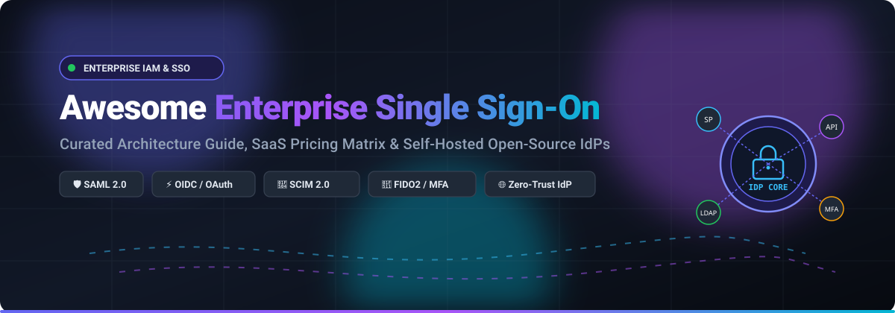

 
 

  <strong>Curated Guide to Enterprise Single Sign-On (SSO), Identity &amp; Access Management (IAM), SAML 2.0 / OIDC Federation, and Self-Hosted Identity Providers</strong>

  <a href="#-sector-overview--market-dynamics">Sector Dynamics</a> •
  <a href="#-saashosted-platforms">SaaS Pricing Matrix</a> •
  <a href="#-open-source-github-projects">Open-Source IdPs</a> •
  <a href="#-how-to-contribute">Contribute</a> •
  <a href="#-support--sponsor">Support</a> •
  <a href="#-star-history">Star History</a>

---

## 🚀 Overview & Architecture

Welcome to the **Awesome Enterprise Single Sign-On (SSO)** repository! This collection tracks premier **SaaS identity suites** and production-ready **open-source identity providers (IdPs)** that power modern enterprise authentication, federation, and access security.

Whether you are designing a Zero-Trust architecture, implementing workforce federated authentication with **SAML 2.0**, **OIDC (OpenID Connect)**, or **OAuth 2.0**, synchronizing directories with **SCIM 2.0**, or migrating away from per-MAU SaaS vendor lock-in to self-hosted software, this guide provides actionable intelligence, transparent pricing, and direct technical comparisons.

---

## 📊 Sector Overview & Market Dynamics

The global **Enterprise Single Sign-On (SSO) and Identity & Access Management (IAM)** market is estimated at **$18.5 Billion to $22.0 Billion**, expanding at an estimated **13–15% CAGR** driven by zero-trust mandates, hybrid-cloud sprawl, and cyber insurance compliance requirements. 

Market dynamics reflect a **moderately concentrated, bifurcated ecosystem**: mega-cloud ecosystems (**Microsoft Entra ID** and **Google Workspace**) dominate baseline workforce directory seats through productivity bundle lock-ins, while specialized standalone leaders (**Okta**, **CyberArk**, **Ping Identity**) capture complex multi-cloud enterprise federation; in parallel, developer-friendly open-source alternatives (**Keycloak**, **Authentik**, **ZITADEL**) are rapidly capturing cloud-native and sovereignty-conscious infrastructure workloads.

---

## 🏢 SaaS/Hosted Platforms

The table below benchmarks commercial workforce identity and SSO platforms. Entries are sorted in descending order by **Company Size (Revenue / Market Capitalization / Valuation)**.

| Product | Company Size (Rev / Valuation) | Description | Starting Pricing Tier | Free Tier &amp; Trial Limits |
| :--- | :--- | :--- | :--- | :--- |
| **[Microsoft Entra ID](https://www.microsoft.com/en-us/security/business/identity-access/microsoft-entra-id)** | **~$3.1 Trillion** (Market Cap) / **~$245B+** Ann. Rev | 🏢 Default for Microsoft 365 enterprises. Features SAML 2.0 / OIDC federation, Conditional Access, and hybrid directory sync. | **P1: $7.00/user/month** (annual); **P2: $10.00/user/month** (annual); Suite bundled in M365 E3/E5. | **Free edition** included with Azure/M365 accounts (unlimited users for core directory/SSO); **30-day free trial** for P1/P2. |
| **[Google Workspace](https://workspace.google.com/)** | **~$2.1 Trillion** (Alphabet Cap) / **~$350B+** Ann. Rev | 🌐 Cloud-native SAML/OIDC Identity Provider built directly into Google Workspace and Cloud Identity. | **Business Starter: $7.00/user/month** (annual contract); Flexible plan: **$8.40/user/month**. | **14-day free trial** (up to 10 users); Cloud Identity Free edition offers **free tier for up to 50 users** (SSO included). |
| **[CyberArk Identity](https://www.cyberark.com/)** | **~$15 Billion** (Market Cap) / **~$1.0B+** Ann. Rev | 🔐 Modular workforce IAM and privileged access management with adaptive MFA and SSO federation. | **SSO Module: $2.00/user/month**; Adaptive MFA: **$3.00/user/month**; Workforce Password: **$5.00/user/month**. | **30-day free trial** with access to full features for up to 100 users; No permanent free tier. |
| **[Okta](https://www.okta.com/)** | **~$12 Billion** (Market Cap) / **~$2.6B+** Ann. Rev | 🛡️ The independent enterprise identity benchmark. Bundles SSO, MFA, Universal Directory, and API Access Management. | **Starter Suite: $6.00/user/month** (annual billing; subject to **$1,500/year minimum contract**); **Essentials: $17.00/user/month**. | **30-day free trial** with all workforce features enabled (up to 25 users); No permanent free plan. |
| **[Duo Security](https://duo.com/editions-and-pricing)** | **~$2.35B** (Acquired by Cisco, ~$230B Cap) | 📱 Cloud identity, continuous zero-trust device posture checks, MFA, and SAML/OIDC Single Sign-On. | **Duo Essentials: $3.00/user/month** (includes SSO); Advantage: **$6.00/user/month**; Premier: **$9.00/user/month**. | **Duo Free: Forever free for up to 10 users** (core 2FA/MFA; SSO requires Essentials); **30-day free trial** of Essentials/Advantage. |
| **[Auth0](https://auth0.com/pricing)** | **~$6.5B** (Acquired by Okta) | 💻 Developer-first identity-as-a-service (IDaaS) with extensive SDKs, Universal Login, and enterprise SAML connections. | **Self-Service SSO requires Enterprise Plan** (Custom quote, starting at **~$1,500/month**); Developer tier starts at **$35/month**. | **Free forever plan: Up to 25,000 MAUs** (B2C/social logins only; Enterprise SSO requires paid plan); **22-day free trial** of Enterprise features. |
| **[OneLogin](https://www.onelogin.com/)** | **~$1.5B+** (One Identity / Quest Software) | 🔑 Mid-market enterprise SSO and access management with SmartFactor authentication and directory connector. | **Basic: $3.00/user/month**; **Essentials: $6.00/user/month**; **Business: $10.00/user/month** (annual prepayment; implementation adds $5K–$15K). | **30-day free trial** with unlimited app integrations and directory connector access; No permanent free tier. |
| **[JumpCloud](https://jumpcloud.com/)** | **~$2.6 Billion** (Private Valuation) | 💻 Unified open directory platform combining cloud LDAP, SAML 2.0/OIDC SSO, and cross-OS device MDM management. | **SSO Package: $11.00/user/month** (annual contract); Core Directory platform: **$15.00/user/month**. | **JumpCloud Free: Forever free for up to 10 users and 10 devices** (includes SSO, LDAP, and device management with 10 days premium support). |

---

## 💻 Open-Source GitHub Projects

Self-hosted and open-source identity providers (IdPs) provide full data ownership, compliance autonomy, and immunity from recurring per-user SaaS license fees.

The table below is sorted in descending order by **GitHub_Stars**:

| Project | GitHub_Stars_Badge | Description | Primary Protocols |
| :--- | :--- | :--- | :--- |
| **[Keycloak](https://github.com/keycloak/keycloak)** |  | 🛡️ **The de facto industry benchmark for open-source IAM and SSO.** Maintained by Red Hat and part of the CNCF. Supports multi-realm multi-tenancy, identity brokering, user federation with LDAP/AD, and fine-grained authorization with zero per-user licensing. | SAML 2.0, OIDC, OAuth 2.0, LDAP, Kerberos |
| **[Authelia](https://github.com/authelia/authelia)** |  | 🔒 **High-performance authentication &amp; authorization companion.** Acts as a companion portal alongside reverse proxies (Nginx, Traefik, HAProxy, Envoy, Caddy) providing multi-factor authentication, Passkeys (WebAuthn), and OIDC provider capabilities. | OIDC, OAuth 2.0, Forward Auth, WebAuthn |
| **[Authentik](https://github.com/goauthentik/authentik)** |  | ⚡ **Modular, user-friendly open-source IdP with visual flow execution.** Features drag-and-drop authentication pipelines, native SCIM outbound provisioning, built-in reverse proxy forward-auth, and unified social/enterprise federation. | SAML 2.0, OIDC, OAuth 2.0, SCIM 2.0, LDAP, Forward Auth |
| **[Ory Hydra](https://github.com/ory/hydra)** |  | ⚡ **Hardened, headless OAuth 2.0 and OpenID Connect (OIDC) engine.** Built in Go, Hydra implements OpenID Foundation certified specs without enforcing opinionated UI, letting you build custom login, consent, and registration flows. | OIDC, OAuth 2.0 |
| **[ZITADEL](https://github.com/zitadel/zitadel)** |  | 📜 **Event-sourced cloud-native identity platform.** Written in Go with an API-first approach (gRPC, REST, connectRPC). Features strict multi-tenancy (Instance &gt; Org &gt; Project), immutable audit trails, and out-of-the-box Passkey/FIDO2 authentication. | SAML 2.0, OIDC, OAuth 2.0, SCIM 2.0, FIDO2 |
| **[OAuth2 Proxy](https://github.com/oauth2-proxy/oauth2-proxy)** |  | 🛡️ **Reverse proxy that protects upstream web services using identity providers.** Validates authentication through OpenID Connect or standard OAuth2 providers (Google, GitHub, Keycloak, Okta, Azure AD) and passes verified user headers. | OIDC, OAuth 2.0 |
| **[SuperTokens](https://github.com/supertokens/supertokens-core)** |  | 🔑 **Modular open-source authentication architecture.** Offers an extensible alternative to Auth0/Firebase with support for third-party SSO (SAML/OIDC enterprise providers), passwordless login, social logins, and secure session management. | SAML 2.0, OIDC, OAuth 2.0, Session Tokens |
| **[Casdoor](https://github.com/casdoor/casdoor)** |  | 🚀 **Lightweight Go &amp; React UI identity and access management platform.** Single binary deployment with support for 70+ identity providers, built-in SCIM, CAS 1.0–3.0, RADIUS, LDAP, and a native Model Context Protocol (MCP) server for AI agents. | SAML 2.0, OIDC, OAuth 2.0, CAS, SCIM, RADIUS, LDAP |
| **[Ory Kratos](https://github.com/ory/kratos)** |  | 🧬 **API-first identity, user management, and credential store.** Native support for Passkeys/WebAuthn, multi-factor authentication (TOTP/SMS), self-service registration/recovery, and identity schema customization without UI lock-in. | OIDC, OAuth 2.0, WebAuthn, TOTP |
| **[Apereo CAS](https://github.com/apereo/cas)** |  | 🎓 **Battle-tested enterprise single sign-on server built on Java/Spring Boot.** Widely deployed across universities, governments, and large enterprises. Supports comprehensive federation protocols and multidirectional identity translation. | CAS 1.0–3.0, SAML 2.0, OIDC, OAuth 2.0, WS-Federation, RADIUS |
| **[Dex](https://github.com/dexidp/dex)** |  | ☸️ **CNCF OpenID Connect (OIDC) identity provider with pluggable connectors.** Functions as an authentication intermediary bridging Kubernetes clusters and cloud infrastructure with upstream SAML, LDAP, GitHub, and OAuth providers. | OIDC, OAuth 2.0, SAML, LDAP |
| **[Kanidm](https://github.com/kanidm/kanidm)** |  | 🦀 **Modern, secure identity management platform and directory written in Rust.** Designed to replace traditional OpenLDAP and Active Directory with built-in OAuth2/OIDC, WebAuthn, PAM integration, and strict memory safety. | OIDC, OAuth 2.0, LDAP, PAM, WebAuthn |
| **[WSO2 Identity Server](https://github.com/wso2/product-is)** |  | 🏛️ **Enterprise-grade CIAM and workforce identity server.** Recognized by the Digital Public Goods Alliance, utilized in 90+ countries for mission-critical digital identity, adaptive authentication, and fine-grained access management. | SAML 2.0, OIDC, OAuth 2.0, SCIM 2.0, FIDO2, WS-Trust |
| **[Janssen Project](https://github.com/JanssenProject/jans)** |  | 🌐 **Linux Foundation cloud-native identity platform.** Evolution of the Gluu Server engineered for national scale, auto-scaling Kubernetes deployments, Agama low-code flow orchestration, and high-throughput OAuth2/OIDC authorization. | OIDC, OAuth 2.0, SAML 2.0, SCIM, FIDO2 |

---

## 🛠️ Protocols &amp; Standards Comparison

| Protocol | Primary Use Case | Transport / Format | Security Strengths | Common Implementations |
| :--- | :--- | :--- | :--- | :--- |
| **SAML 2.0** | Enterprise B2B &amp; Workforce Web SSO | XML over HTTP POST / Redirect | XML Signature, encryption, established trust certificates | Okta, Entra ID, Keycloak, CAS, Shibboleth |
| **OIDC (OpenID Connect)** | Modern Web, Mobile &amp; API Identity | JSON / JWT over REST HTTPS | Cryptographically signed ID Tokens, PKCE protection | Authentik, Ory Hydra, ZITADEL, Auth0 |
| **OAuth 2.0** | Delegated Authorization &amp; API Scopes | JSON Bearer Tokens / Headers | Granular scopes, refresh token rotation, MTLS | Dex, Casdoor, Keycloak, Hydra |
| **SCIM 2.0** | Automated User &amp; Group Provisioning | REST JSON API | Automated lifecycle syncing, immediate deprovisioning | Entra ID, Okta, Authentik, Casdoor |
| **FIDO2 / WebAuthn** | Passwordless &amp; Phishing-Resistant MFA | Public-key cryptography (Hardware) | Origin binding, resistant to credential theft and SIM swaps | Duo, ZITADEL, Kanidm, Authelia |

---

## 🤝 How to Contribute

We welcome contributions to expand and refine this ecosystem guide! 🎉

1. 🍴 Fork the repository.
2. 🌿 Create a new feature branch (`git checkout -b feature/add-new-sso-tool`).
3. 📝 Update `README.md` following the exact table structure and format.
4. 🧪 Ensure all links are live, pricing is verified, and GitHub Stars_Badges follow the standard syntax.
5. 🚀 Submit a Pull Request with a brief description of the addition or update.

---

## 💖 Support &amp; Sponsor

If you find this repository helpful for your architecture research, enterprise evaluations, or homelab setup, consider supporting the maintenance of this open resource:

- ⭐ **Star this repository** to help others discover it!
- 🍴 **Fork it** and share it with your IT, security, and DevOps teams.
- ☕ **Buy a coffee &amp; sponsor future development:** [**GitHub Sponsors Dashboard (ishandutta2007)**](https://github.com/sponsors/ishandutta2007)

Thank you to all community contributors and identity security practitioners worldwide! 🙌

---

## 📈 Star History

---

## ⚠️ Disclaimer

- This curated directory is for educational and technical evaluation purposes; inclusion does not constitute endorsement.
- Single Sign-On platforms manage root security credentials and directory trust. Always enforce multi-factor authentication (MFA/Passkeys), configure least-privilege role-based access control (RBAC), and conduct rigorous security audits prior to deploying any identity solution in production.
